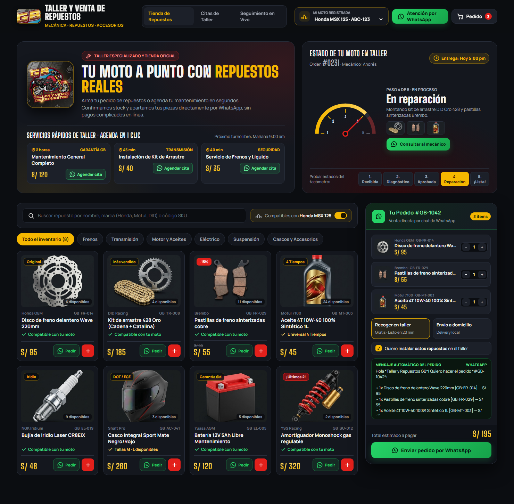
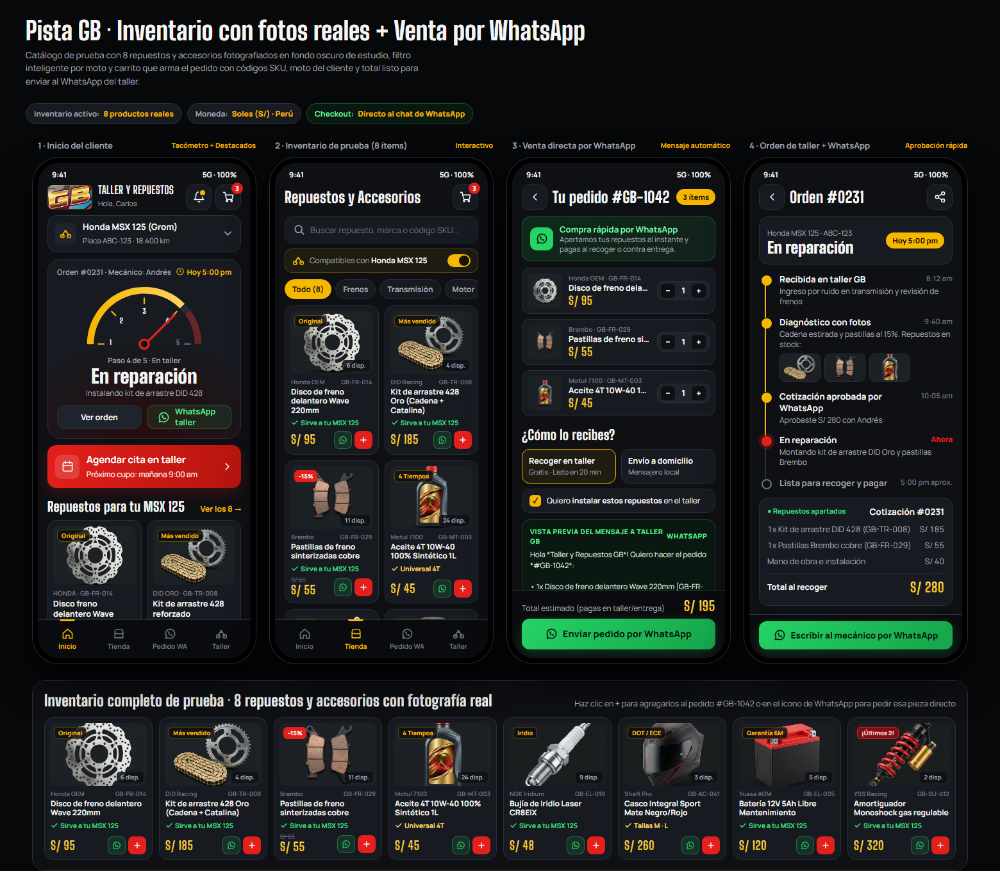

# 🏍️ GB Taller y Venta de Repuestos — Web & App (Estilo Pista GB)

Aplicación web y prototipo móvil para **GB Taller y Venta de Repuestos** (servicios mecánicos, venta de repuestos originales y accesorios para motocicletas con cierre de pedidos y agendamiento directo por **WhatsApp**).



---

## ✨ Características principales

- **Catálogo interactivo con fotografías reales:** 8 repuestos y accesorios organizados en 6 categorías (*Frenos, Transmisión, Motor, Eléctrico, Suspensión y Accesorios*), con códigos SKU, stock disponible y precios en **Soles (`S/`)**.
- **Filtro inteligente por motocicleta ("Mi Moto"):** permite elegir la moto registrada del cliente (`Honda MSX 125`, `Yamaha NMAX 155`, `Pulsar NS 200`) y filtrar repuestos compatibles.
- **Tacómetro interactivo de seguimiento de taller (`Orden #0231`):** muestra en tiempo real los 5 pasos del servicio mecánico (*1. Recibida → 2. Diagnóstico → 3. Aprobada → 4. En reparación → 5. ¡Lista!*) con fotos de diagnóstico.
- **Venta y agendamiento directo por WhatsApp:**
  - Botón rápido en cada producto para pedir o consultar una pieza individual.
  - Carrito de compras que arma automáticamente el pedido con códigos SKU, cantidades, modalidad de entrega (*Recoger en taller* o *Envío a domicilio*), opción de *Instalación en el taller* y total a pagar, redirigiendo directamente al chat de WhatsApp del taller sin exponer el número en los botones.

---

## 📱 Vista Móvil (4 Pantallas Interactivas)



---

## 📁 Estructura del proyecto

```text
gb-taller-web/
├── index.html                  # Versión Web principal (Desktop + Responsive)
├── mobile.html                 # Showcase interactivo de las 4 pantallas móviles
├── README.md                   # Documentación del repositorio
└── assets/
    ├── logo-gb-marca.png       # Emblema GB recortado para barra superior
    ├── logo-gb-oscuro.jpg      # Logo oficial GB sobre fondo oscuro
    ├── logo-gb-claro.jpg       # Variante clara del logo GB
    ├── logo-gb-banner.jpg      # Variante horizontal del logo GB
    ├── preview-web.png         # Captura de la Versión Web
    ├── preview-mobile.png      # Captura de las 4 pantallas móviles
    └── productos/              # Fotografías reales del inventario
        ├── disco-freno.jpg
        ├── kit-arrastre.jpg
        ├── pastillas-freno.jpg
        ├── aceite-4t.jpg
        ├── bujia-iridio.jpg
        ├── casco-integral.jpg
        ├── bateria-agm.jpg
        └── amortiguador.jpg
```

---

## 🚀 Cómo publicarlo gratis en GitHub Pages

1. Sube el contenido de esta carpeta (`gb-taller-web`) a un repositorio en tu cuenta de GitHub.
2. En GitHub, entra a **Settings → Pages**.
3. En **Branch**, selecciona `main` y carpeta `/ (root)`, y haz clic en **Save**.
4. Tu tienda web quedará publicada en `https://<tu-usuario>.github.io/<nombre-del-repo>/`.
